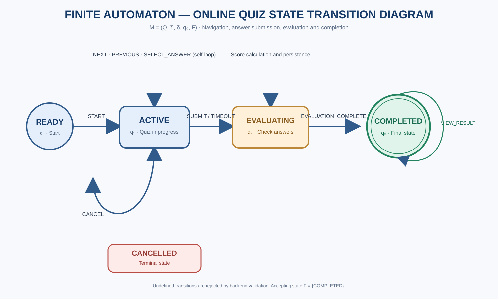
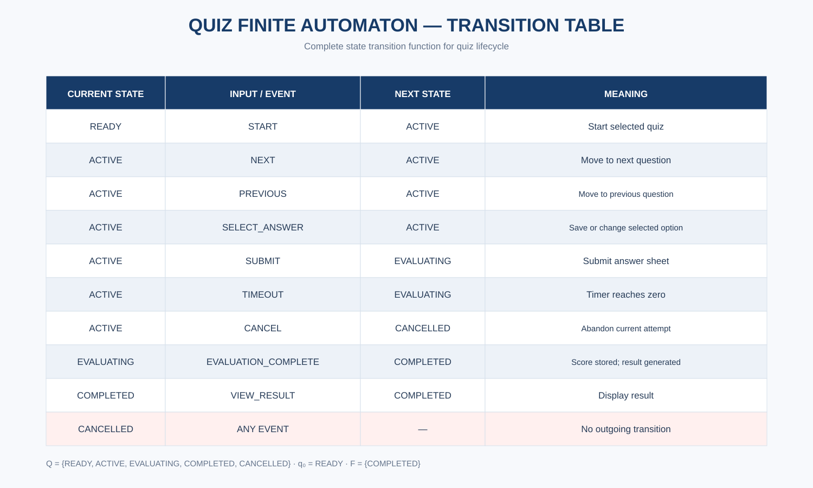

# 22ITT53 — Formal Languages and Automata Theory (FLAT)

## DFA-style quiz lifecycle
The quiz lifecycle is represented by M = (Q, Σ, δ, q₀, F).

- Q = {READY, ACTIVE, EVALUATING, COMPLETED, CANCELLED}
- Σ = {START, NEXT, PREVIOUS, SELECT_ANSWER, SUBMIT, TIMEOUT, EVALUATION_COMPLETE, VIEW_RESULT, CANCEL}
- q₀ = READY
- F = {COMPLETED}
- δ is defined by the transition table below. Undefined transitions are rejected.

## State transition diagram

File: `transition-diagram.svg` — full lifecycle diagram with start, active self-loops, evaluation, accepting state and cancellation.

## State transition table

| Current state | Input/event | Next state | Meaning |
|---|---|---|---|
| READY | START | ACTIVE | Start selected quiz |
| ACTIVE | NEXT | ACTIVE | Move to next question |
| ACTIVE | PREVIOUS | ACTIVE | Move to previous question |
| ACTIVE | SELECT_ANSWER | ACTIVE | Save/change selected option |
| ACTIVE | SUBMIT | EVALUATING | Submit answer sheet |
| ACTIVE | TIMEOUT | EVALUATING | Timer reaches zero |
| ACTIVE | CANCEL | CANCELLED | Abandon current attempt |
| EVALUATING | EVALUATION_COMPLETE | COMPLETED | Score stored and result generated |
| COMPLETED | VIEW_RESULT | COMPLETED | Display result |
| CANCELLED | Any event | — | No outgoing transition |

## Validation examples
- READY + START → ACTIVE: valid.
- ACTIVE + NEXT → ACTIVE: valid self-loop.
- ACTIVE + SUBMIT → EVALUATING: valid.
- EVALUATING + EVALUATION_COMPLETE → COMPLETED: valid.
- READY + SUBMIT, COMPLETED + SUBMIT and CANCELLED + NEXT: invalid.

## Project implementation
`backend/src/fsm.js` contains the transition map and rejects undefined transitions. The backend checks ACTIVE → EVALUATING → COMPLETED before returning a result. The answer key remains on the server. Registration and quiz submission inputs are validated on the server.
